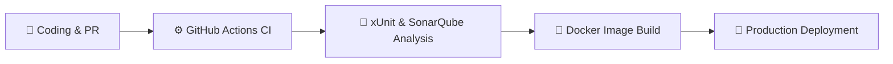
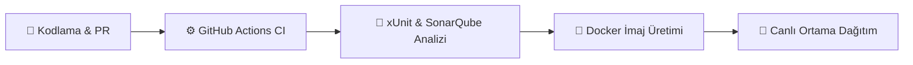

# 🥗 OleAI — AI-Powered Smart Recipe and Kitchen Assistant

**🥗 OleAI — Yapay Zekâ Destekli Akıllı Tarif ve Mutfak Asistanı**

**🌐 Language / Dil:** &nbsp; [🇬🇧 English](#en) &nbsp;|&nbsp; [🇹🇷 Türkçe](#tr)

---

> 🇹🇷 Türkçe okumak için: **[Türkçe sürüme git ↓](#tr)**

**An end-to-end smart kitchen ecosystem that prevents food waste, manages your kitchen inventory, and delivers personalized recipes based on the ingredients you have.**

[Features](#key-features) • [Architecture and Modules](#project-modules-and-source-code) • [Tech Stack](#tech-stack) • [Documentation](#project-documentation) • [CI/CD Process](#engineering-and-cicd-process)

---

## About the Project

**OleAI** goes beyond a standard recipe app: it is an AI-powered platform that tracks your kitchen inventory (**My Pantry / "Dolabım"**) in real time and learns your consumption habits and taste. It aims to reduce food waste by making the most efficient use of the ingredients at home, and to answer the question *"What should I cook today?"* with the best possible result within seconds.

### Key Features

* **AI-Powered Recommendation Engine:** Scores and ranks the most suitable recipes using **TF-IDF** and **Cosine Similarity** algorithms, based on your available ingredients, dietary preferences, and past interactions.
* **Smart Kitchen Inventory (My Pantry):** Manages home ingredients with quantities and expiration dates; automatically deducts the amounts used from stock after a dish is cooked.
* **Automatic Shopping List:** Transfers low-stock or missing recipe ingredients to your dynamic shopping list with a single tap.
* **Social Interaction and Community:** Lets users share their own recipes, and rate and comment on recipes.
* **Enterprise-Grade Security:** JWT (JSON Web Token) based authentication, a Refresh Token mechanism, and Role-Based Access Control (RBAC).

---

## Project Modules and Source Code

OleAI consists of 4 main application layers that can run and scale independently of one another. You can reach the source code and setup instructions of each module through the links below:

| Module | Description | Source Code / Directory |
| :--- | :--- | :--- |
| **Backend API** | The central RESTful API, built with Clean Architecture principles, that manages business rules and database operations. | [Backend](https://github.com/onuraydi/OleAI-backend) |
| **AI Engine** | A microservice hosting recipe matching, natural language processing (NLP), and vector space models. | [AI Service](https://github.com/onuraydi/OleAI-ai) |
| **Web Client** | A modern, fast interface where users can discover recipes and manage their pantry on a large screen. | [Web](https://github.com/onuraydi/OleAI-web) |
| **Mobile App** | An Android app with a modern declarative UI that delivers native performance for practical use in the kitchen. | [Mobile](https://github.com/onuraydi/OleAI-android) |

---

## Tech Stack

The system is built on **Clean Architecture** principles to be sustainable, testable, and scalable.

| Layer | Technologies and Tools | Related Module |
| :--- | :--- | :--- |
| **Backend** | .NET 9, ASP.NET Core Web API, Entity Framework Core | [🔗 Backend](https://github.com/onuraydi/OleAI-backend) |
| **Artificial Intelligence (AI)** | Python, FastAPI, Scikit-learn (TF-IDF, Cosine Similarity) | [🔗 AI Engine](https://github.com/onuraydi/OleAI-ai) |
| **Frontend (Web)** | React, Vite, Tailwind CSS | [🔗 Web UI](https://github.com/onuraydi/OleAI-web) |
| **Frontend (Mobile)** | Kotlin, Jetpack Compose | [🔗 Android App](https://github.com/onuraydi/OleAI-android) |
| **Database** | Microsoft SQL Server (MSSQL) | - |
| **DevOps & Infrastructure** | Docker, Kubernetes, GitHub Actions | - |
| **Quality & Testing** | xUnit, Moq, Selenium, SonarQube | - |

---

## Project Documentation

You can access all the analysis, architecture design, testing, and management documents prepared within the project's software development life cycle (SDLC) below:

| # | Document Title | Scope and Content Summary | Link |
| :-: | :--- | :--- | :---: |
| **01** | **Requirements Analysis** | User Stories, Functional and Non-Functional Requirements (FR/NFR), Risk Analysis | [📄 View](./GereksinimAnalizi/2.GereksinimAnaliziDocument.md) |
| **02** | **System Design and Architecture** | System Architecture, UML Diagrams, Database Design (ER Diagram), Sequence Diagrams | [📄 View](./SistemTasarimi/3.sistemTasarimi.md) |
| **03** | **Test Plan and Scenarios** | Test Strategies, Unit and Integration Tests, Detailed Test Scenarios (Auth, Recipe, AI, Security), Test Case Tables | [📄 View](./TestPlani/4.TestDocument.md) |
| **04** | **DevOps and CI/CD** | CI/CD Pipeline Flow, DevOps Architecture Diagram, Docker Containerization and Deployment Processes | [📄 View](./DevOpsEntegrasyonu/5.DevOpsEngterasyonu.md) |
| **05** | **Project Management** | Gantt Chart, Timeline, Work Packages, Task Distribution, and Progress Tracking | [📄 View](./ProjeYonetimi/6.ProjeYonetimi.md) |

---

## Engineering and CI/CD Process

A fully automated, end-to-end **CI/CD pipeline** is operated to standardize code quality and ensure error-free delivery:

[⬆ Back to top](#) &nbsp;|&nbsp; [🇹🇷 Türkçe sürüme git](#tr)

---
---

> 🇬🇧 To read in English: **[Go to the English version ↑](#en)**

**Gıda israfını önleyen, mutfak envanterinizi yöneten ve elinizdeki malzemelere göre kişiselleştirilmiş tarifler sunan uçtan uca akıllı mutfak ekosistemi.**

[Özellikler](#temel-özellikler) • [Mimari ve Modüller](#proje-modülleri-ve-kaynak-kodlar) • [Teknoloji Yığını](#teknoloji-yığını) • [Dokümantasyon](#proje-dokümantasyonu) • [CI/CD Süreci](#mühendislik-ve-cicd-süreci)

---

## Proje Hakkında

**OleAI**, standart bir tarif uygulamasının ötesine geçerek mutfak envanterinizi (**Dolabım**) gerçek zamanlı takip eden, tüketim alışkanlıklarınızı ve damak zevkinizi öğrenen yapay zekâ destekli bir platformdur. Evdeki mevcut malzemeleri en verimli şekilde değerlendirerek gıda israfını azaltmayı ve *"Bugün ne pişirsem?"* sorusuna saniyeler içinde en optimum yanıtı vermeyi hedefler.

### Temel Özellikler

* **Yapay Zekâ Destekli Öneri Motoru:** Mevcut malzemelerinize, beslenme tercihlerinize ve geçmiş etkileşimlerinize göre **TF-IDF** ve **Kosinüs Benzerliği (Cosine Similarity)** algoritmalarını kullanarak en uygun tarifleri puanlar ve sıralar.
* **Akıllı Mutfak Envanteri (Dolabım):** Evdeki malzemeleri miktar ve son kullanma tarihleriyle yönetir; pişen yemeklerin ardından kullanılan gramajları stoktan otomatik düşer.
* **Otomatik Alışveriş Listesi:** Azalan veya tarif için eksik olan malzemeleri tek tıkla dinamik alışveriş listenize aktarır.
* **Sosyal Etkileşim ve Topluluk:** Kullanıcıların kendi özel tariflerini paylaşmasına, tarifleri puanlamasına ve yorumlamasına olanak tanır.
* **Kurumsal Düzeyde Güvenlik:** JWT (JSON Web Token) tabanlı kimlik doğrulama, Refresh Token mekanizması ve Rol Bazlı Erişim Kontrolü (RBAC).

---

## Proje Modülleri ve Kaynak Kodlar

OleAI, birbirinden bağımsız çalışabilen ve ölçeklenebilen 4 ana uygulama katmanından oluşmaktadır. İlgili modülün kaynak kodlarına ve kurulum yönergelerine aşağıdaki bağlantılardan ulaşabilirsiniz:

| Modül | Açıklama | Kaynak Kod / Dizin |
| :--- | :--- | :--- |
| **Backend API** | Clean Architecture prensipleriyle geliştirilmiş, iş kurallarını ve veritabanı işlemlerini yöneten merkezi RESTful API. | [Backend](https://github.com/onuraydi/OleAI-backend) |
| **AI Engine** | Tarif eşleştirme, doğal dil işleme (NLP) ve vektör uzay modellerini barındıran mikroservis. | [AI Servisi](https://github.com/onuraydi/OleAI-ai) |
| **Web İstemcisi** | Kullanıcıların büyük ekranda tarif keşfi ve kiler yönetimi yapabildiği modern, hızlı arayüz. | [Web](https://github.com/onuraydi/OleAI-web) |
| **Mobil Uygulama** | Mutfakta pratik kullanım için yerel (native) performans sunan, modern deklaratif UI tabanlı Android uygulaması. | [Mobil](https://github.com/onuraydi/OleAI-android) |

---

## Teknoloji Yığını

Sistem; sürdürülebilir, test edilebilir ve ölçeklenebilir **Clean Architecture** prensipleri temel alınarak inşa edilmiştir.

| Katman | Teknoloji ve Araçlar | İlgili Modül |
| :--- | :--- | :--- |
| **Backend** | .NET 9, ASP.NET Core Web API, Entity Framework Core | [🔗 Backend](https://github.com/onuraydi/OleAI-backend) |
| **Yapay Zekâ (AI)** | Python, FastAPI, Scikit-learn (TF-IDF, Cosine Similarity) | [🔗 AI Engine](https://github.com/onuraydi/OleAI-ai) |
| **Frontend (Web)** | React, Vite, Tailwind CSS | [🔗 Web UI](https://github.com/onuraydi/OleAI-web) |
| **Frontend (Mobil)** | Kotlin, Jetpack Compose | [🔗 Android App](https://github.com/onuraydi/OleAI-android) |
| **Veritabanı** | Microsoft SQL Server (MSSQL) | - |
| **DevOps & Altyapı** | Docker, Kubernetes, GitHub Actions | - |
| **Kalite & Test** | xUnit, Moq, Selenium, SonarQube | - |

---

## Proje Dokümantasyonu

Projenin yazılım yaşam döngüsü (SDLC) kapsamında hazırlanan tüm analiz, mimari tasarım, test ve yönetim belgelerine aşağıdan erişebilirsiniz:

| # | Doküman Başlığı | Kapsam ve İçerik Özeti | Bağlantı |
| :-: | :--- | :--- | :---: |
| **01** | **Gereksinim Analizi** | Kullanıcı Hikayeleri (User Stories), Fonksiyonel ve Fonksiyonel Olmayan Gereksinimler (FR/NFR), Risk Analizi | [📄 İncele](./GereksinimAnalizi/2.GereksinimAnaliziDocument.md) |
| **02** | **Sistem Tasarımı ve Mimari** | Sistem Mimarisi, UML Diyagramları, Veritabanı Tasarımı (ER Diyagramı), Sequence (Sıralama) Diyagramları | [📄 İncele](./SistemTasarimi/3.sistemTasarimi.md) |
| **03** | **Test Planı ve Senaryoları** | Test Stratejileri, Birim ve Entegrasyon Testleri, Detaylı Test Senaryoları (Auth, Tarif, AI, Güvenlik), Test Case Tabloları | [📄 İncele](./TestPlani/4.TestDocument.md) |
| **04** | **DevOps ve CI/CD** | CI/CD Pipeline Akışı, DevOps Mimari Diyagramı, Docker Konteynerizasyon ve Dağıtım Süreçleri | [📄 İncele](./DevOpsEntegrasyonu/5.DevOpsEngterasyonu.md) |
| **05** | **Proje Yönetimi** | Gantt Şeması, Zaman Çizelgesi, İş Paketleri, Görev Dağılımı ve Süreç Takibi | [📄 İncele](./ProjeYonetimi/6.ProjeYonetimi.md) |

---

## Mühendislik ve CI/CD Süreci

Kod kalitesini standartlaştırmak ve hatasız teslimat sağlamak amacıyla uçtan uca otomatize edilmiş bir **CI/CD pipeline** işletilmektedir:

[⬆ Başa dön](#) &nbsp;|&nbsp; [🇬🇧 İngilizce sürüme git](#en)

